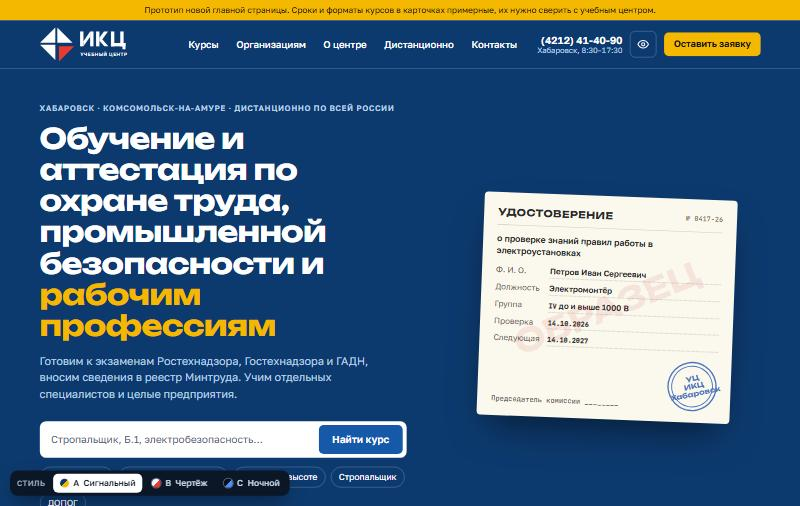
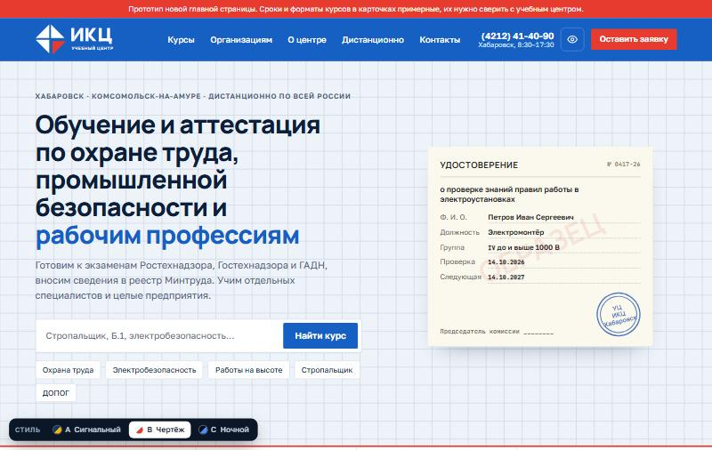
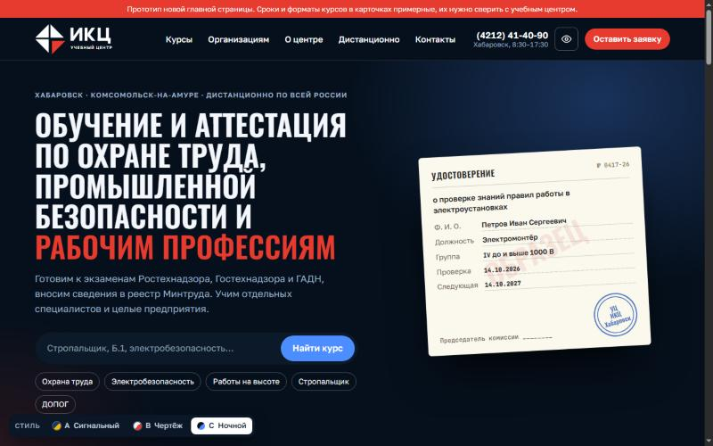

# Редизайн сайта учебного центра ИКЦ — концепт

Новая главная страница учебного центра ИКЦ (Хабаровск, Комсомольск-на-Амуре) в трёх стилях оформления.
Это макет для обсуждения, а не рабочий сайт. Текущий сайт: [uc.ikcgroup.ru](https://uc.ikcgroup.ru/).

Стиль меняется прямо на странице кнопками A / B / C внизу экрана или ссылкой с `#style-a`, `#style-b`, `#style-c`.

## Стиль A — «Сигнальный»

Тёмно-синий фон из нового логотипа и жёлтый, как на строительной разметке.

## Стиль B — «Чертёж»

Светлый инженерный стиль: сетка, синий и красный из логотипа, прямые углы.

## Стиль C — «Ночной»

Тёмный фон со свечением, узкий шрифт заглавными, красный акцент.

## Как посмотреть

Откройте `index.html` в браузере или включите GitHub Pages: **Settings → Pages → Deploy from a branch → `main` / root**.
Страницы закрыты от индексации (`noindex`), чтобы поисковики не путали макет с сайтом учебного центра.

## Файлы

| Файл | Что это |
|---|---|
| `index.html` | Витрина с тремя стилями |
| `prototype.html` | Прототип главной с переключателем стилей |
| `requirements.html` | Проверка по требованиям к сайтам образовательных организаций |
| `img/style-*-desktop.jpg`, `img/style-*-mobile.jpg` | Превью: компьютер и телефон |
